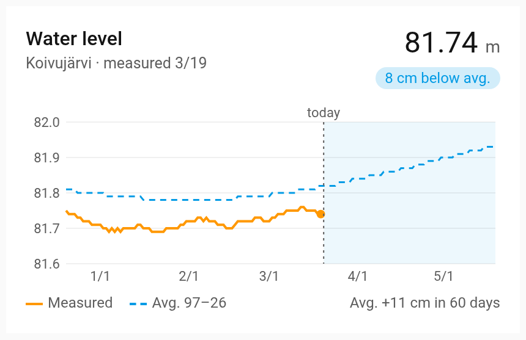
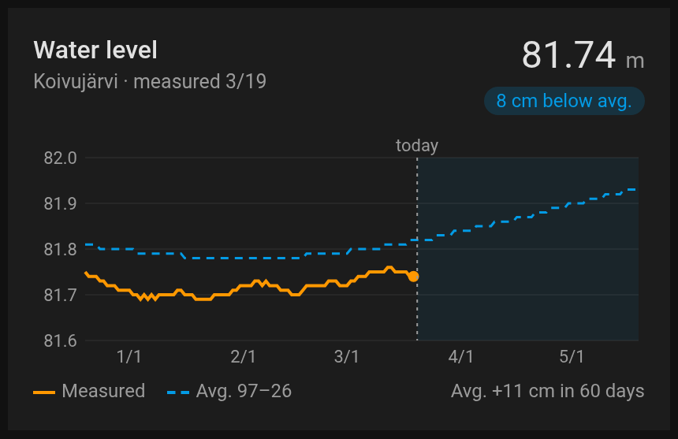
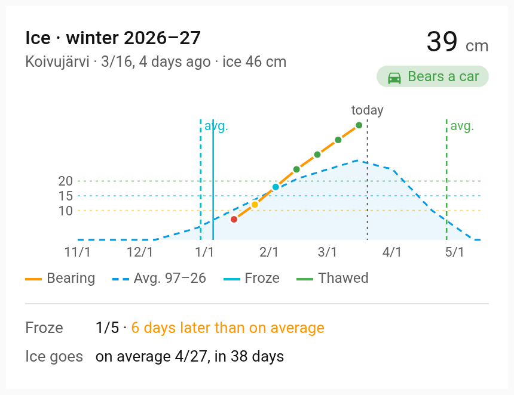
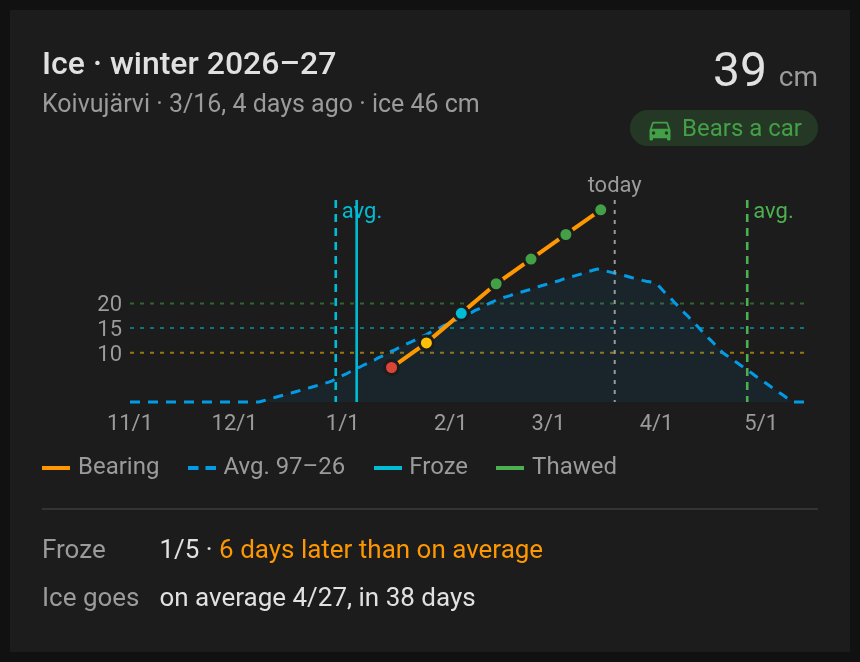
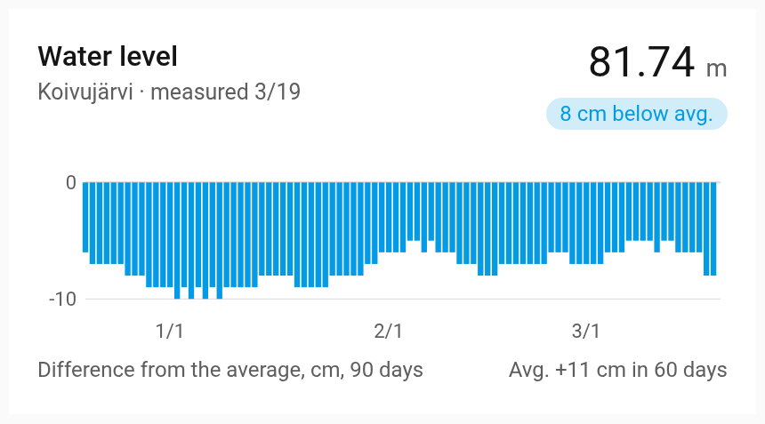
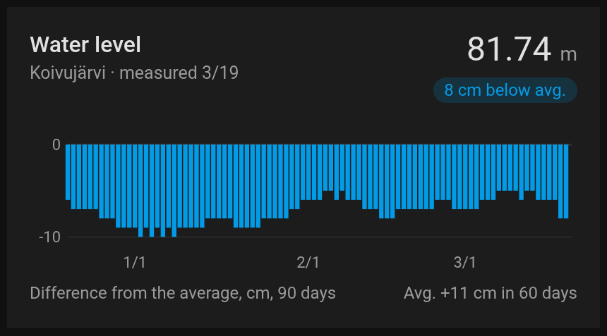
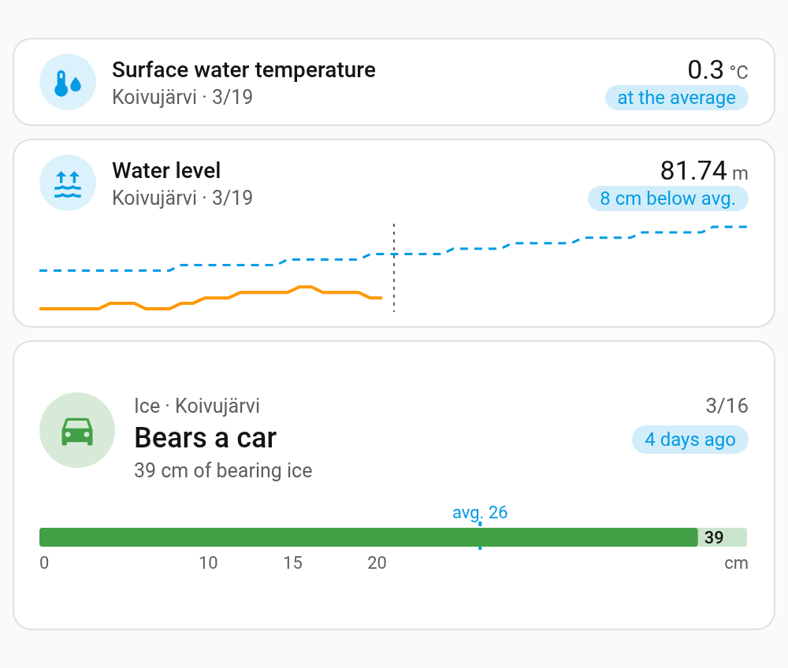
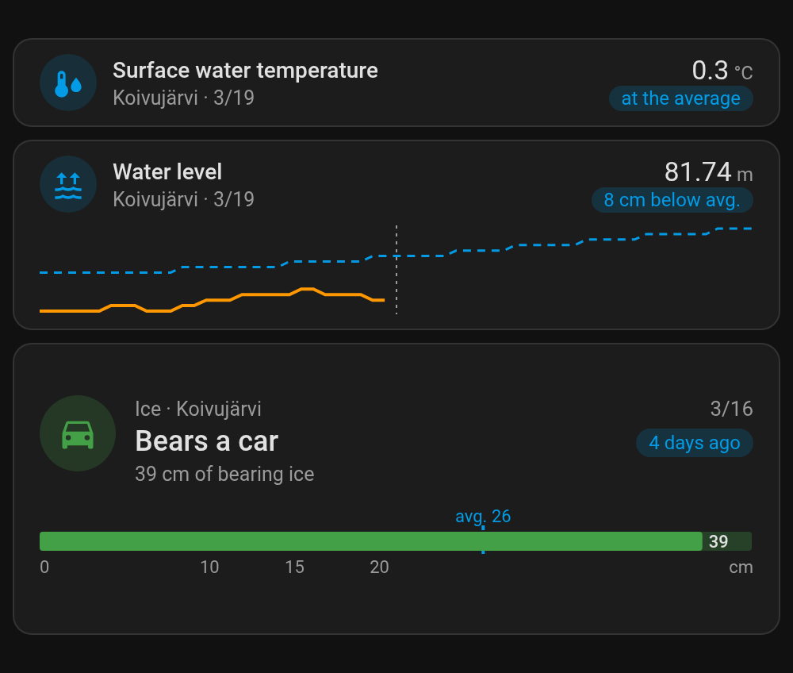

# SYKE hydrology for Home Assistant

Home Assistant integration for the lake and river measurements of the Finnish Environment Institute (Syke). It
follows water level, discharge, water temperature, ice, snow and precipitation, each with its long-term average, and
comes with a dashboard card that draws them.

[![GitHub Release][releases-shield]][releases] [![GitHub Release Date][release-date-shield]][releases] [![Downloads][downloads-shield]][releases] [![Marketplace][marketplace-shield]][marketplace] [![License][license-shield]](LICENSE)


The data in the picture is made up. The cards are the integration's own, see [Hydrology card](#hydrology-card).

## What is it?

A custom component that follows the hydrological measuring stations of the Finnish Environment Institute (Syke)
through its open Hydrologiarajapinta. There are some 1,600 stations around Finland, on lakes, rivers and snow
courses, and no account or key is needed.

You pick what to follow and then the station, from a list with the nearest first. Each measurement becomes a sensor,
and the measurements of one station share a device.

Every measurement also gets a **long-term average** sensor, which tells what the station has measured on this
calendar day over the last thirty full years. With it a chart shows at a glance whether the lake is higher, warmer or more thickly
frozen than usual, and where the average goes from here.

For an ice station the integration works out how much the ice bears, as a thickness and as a class (a person walking,
a snowmobile, a car), with limits you can change.

Sensors get the past year written into their statistics, so charts have a history from the start.

The [hydrology card](#hydrology-card) that comes with the integration draws one measurement against its normal year.
For a station's ice it tells what the ice bears and how old the measurement is, and draws the winter against the
average one.

## Installation

### With the Marketplace

1. Open Settings › Marketplace, choose Add from link and paste `https://github.com/jesmak/syke_hydrology`
2. Open SYKE hydrology in the Marketplace and choose Install
3. Restart Home Assistant
4. Add the integration in Settings › Devices & services, and choose a measurement and a station

### Manual

1. Download the source code from the latest release
2. Copy the `custom_components/syke_hydrology` folder to your Home Assistant installation's `config/custom_components`
   folder
3. Restart Home Assistant
4. Add the integration in Settings › Devices & services, and choose a measurement and a station

## Settings

Adding takes two steps. First choose what to follow, then the station. The list has every station that measures it,
the nearest to your home first with its distance, and it can be searched by the name of a lake, a river, a village or
a municipality.

Each measurement is added on its own, with **Add entry** on the integration's page. A measurement of a station you
already have is added to that station, so its sensors join the same device. Reading thirty years for the averages
takes a few seconds when a measurement is added.

| Name        | Type | Description                               | Default  |
| ----------- | ---- | ----------------------------------------- | -------- |
| Measurement | enum | What to follow, one of the list below     | required |
| Station     | enum | A station that measures it, nearest first | required |

The measurements to choose from:

| Measurement                 | What Syke publishes                                                       |
| --------------------------- | ------------------------------------------------------------------------- |
| Water level                 | A lake's or a river's level, daily                                        |
| Discharge                   | A river's flow, daily                                                     |
| Surface water temperature   | The temperature near the surface, daily                                   |
| Ice thickness               | The ice measured through a drilled hole, about every ten days in winter   |
| Freeze-up and break-up      | The dates the ice came and went, as an observer saw them                  |
| Snow course                 | The snow's water equivalent along a measured course, a few times a winter |
| Areal snow water equivalent | The snow's water equivalent over a catchment area                         |
| Areal precipitation         | The precipitation over a catchment area, for five days and for a month    |

Ice thickness and the freeze-up and break-up dates are often measured at different stations, so they are added
separately and may end up as two devices on the same lake.

### Station settings

A station's **Configure** button has its settings. An ice station has the bearing limits, and a station with more
than one measurement has the list of them, where unticking one removes it with its sensors.

| Name                     | Type   | Description                                                     | Default |
| ------------------------ | ------ | --------------------------------------------------------------- | ------- |
| Bears a person walking   | number | The bearing thickness from which the ice bears a walker, in cm  | 10      |
| Bears a snowmobile       | number | The bearing thickness from which the ice bears a snowmobile, cm | 15      |
| Bears a car              | number | The bearing thickness from which the ice bears a car, in cm     | 20      |
| Measurement is old after | number | Days after which the last ice measurement is marked as old      | 14      |
| Measurements             | list   | The measurements followed at the station                        |         |

## Sensors

The sensors are read from Syke once an hour. Syke publishes the daily measurements a day or two late, and the ones
measured by hand when the observer has sent them in.

A sensor is unavailable when its newest measurement is too old to go by, so a season that ended doesn't draw a flat
line through the summer. The limit is 30 days, 60 days for a snow course and 62 days for a month's precipitation.
Each measurement sensor tells the day of its measurement in its `measured` attribute.

The entity ids below are those of a made-up station named Koivujärvi with Home Assistant in English. In another
language the ids follow that language's names.

| Measurement                 | Sensor                      | State                                             | Example                                         |
| --------------------------- | --------------------------- | ------------------------------------------------- | ----------------------------------------------- |
| Water level                 | Water level                 | Metres in the N2000 height system                 | `sensor.koivujarvi_water_level`                 |
| Discharge                   | Discharge                   | m³/s                                              | `sensor.koivujarvi_discharge`                   |
| Surface water temperature   | Surface water temperature   | °C                                                | `sensor.koivujarvi_surface_water_temperature`   |
| Ice thickness               | Ice thickness               | The whole ice, cm                                 | `sensor.koivujarvi_ice_thickness`               |
|                             | Clear ice thickness         | The clear ice in it, cm                           | `sensor.koivujarvi_clear_ice_thickness`         |
|                             | Snow ice thickness          | The snow ice in it, cm                            | `sensor.koivujarvi_snow_ice_thickness`          |
|                             | Snow on ice                 | The snow on the ice, cm                           | `sensor.koivujarvi_snow_on_ice`                 |
|                             | Ice bearing thickness       | The clear ice and half of the snow ice, cm        | `sensor.koivujarvi_ice_bearing_thickness`       |
|                             | Ice bears                   | `does_not_bear`, `walking`, `snowmobile` or `car` | `sensor.koivujarvi_ice_bears`                   |
|                             | Ice measured                | The date of the newest ice measurement            | `sensor.koivujarvi_ice_measured`                |
|                             | Ice measurement old         | On when that date is older than the limit         | `binary_sensor.koivujarvi_ice_measurement_old`  |
| Freeze-up and break-up      | Freeze-up                   | The date the whole view froze over                | `sensor.koivujarvi_freeze_up`                   |
|                             | Permanent ice cover         | The date the ice stayed for the winter            | `sensor.koivujarvi_permanent_ice_cover`         |
|                             | Ice gone from open water    | The date the open water outside was free of ice   | `sensor.koivujarvi_ice_gone_from_open_water`    |
|                             | Break-up                    | The date the whole view was free of ice           | `sensor.koivujarvi_break_up`                    |
| Snow course                 | Snow water equivalent       | mm of water                                       | `sensor.honkavaara_snow_water_equivalent`       |
| Areal snow water equivalent | Areal snow water equivalent | mm of water                                       | `sensor.koivujarvi_areal_snow_water_equivalent` |
| Areal precipitation         | Precipitation, 5 days       | mm over the newest five days                      | `sensor.koivujarvi_precipitation_5_days`        |
|                             | Precipitation, month        | mm over the newest month                          | `sensor.koivujarvi_precipitation_month`         |

A water level is in centimetres above the station's own zero when Syke gives the station no height system. The
`height_system` attribute tells which it is.

An observer doesn't record every ice event at every station, so a date sensor a station never gets a date for stays
unknown and can be disabled.

### Ice bearing

The **ice bearing thickness** is the clear ice plus half of the snow ice, the rule of thumb the limits are also
given in. It is 0 when the observer found ice too weak to measure. **Ice bears** compares it with the station's
limits.

The limits are rules of thumb, not a guarantee. Ice varies from place to place, one hole says nothing about currents
or cracks, and the measurement may be two weeks old. **Ice measurement old** turns on when it is older than the
station's limit, and the date of the measurement stays available all year.

### Long-term averages

Every measurement sensor has a sensor named after it, such as **Water level, long-term average**
(`sensor.koivujarvi_water_level_long_term_average`). Its state is the average of what the station measured on this
calendar day over the thirty full years before this one, and its `years` attribute tells which years they are. A day
gets an average when at least five of the years have a measurement for it, and a sensor with no such day is left out.

- The averages are read when a measurement is added and again when the year changes.
- Ice and snow courses are measured every ten days or so, so their average for a day is taken from the measurements
  within five days of it.
- The ice averages count open water as zero. Ice is measured only once it bears the observer, so without this the
  average of an early winter day would be that of the years that had ice. A winter counts as open water until ten days
  before its first measurement and from thirty days after its last. The ice averages therefore have a value all year.
- A snow course's average has a value only on the calendar days it has been measured in enough years, which is the
  snow season.
- Each freeze-up and break-up date gets an average date, such as **Freeze-up, long-term average**, in the season
  going on.

### The history

When a measurement is added, the past year is written into its sensors' statistics, the average sensors included, each
measurement at its own date. Every later measurement is written at its own date as well, whenever Syke publishes it.
Charts that read statistics, such as [apexcharts-card](https://github.com/RomRider/apexcharts-card)'s, therefore work from
the first day.

## Hydrology card

<p>




</p>

The integration comes with a dashboard card for one of a station's sensors. A measurement is drawn against its normal
year, the station's long-term average, 90 days back and 60 ahead. Any of a station's ice sensors draws the ice instead:
what it bears, how thick it is, how old the measurement is, and the winter so far against the average one.

The card asks the integration for the measurements and the averages, so it doesn't depend on what the recorder has
kept. A station with several measurements gets a card for each, which can sit in different sections.

The integration serves the card itself and adds it to the dashboards' resources when it starts, so the card is always
the integration's own version. With the resources set in YAML (`resource_mode: yaml`), it can't add or update itself,
and the log says which line to add, change or remove.

### Card options

The card has a visual editor. Add **SYKE hydrology** from the card picker and choose a sensor. The options can also be
written by hand, and `height_mode`, `height` and `max_height` only by hand. In a sections view the layout tab sets the
card's height. They are for where there is no layout tab, such as a masonry or panel view, or a stack or other card the
card is inside, even in a sections view.

| Name          | Type   | Description                                                                                                                                                                                                                                                                                                                | Default                                                                         |
| ------------- | ------ | -------------------------------------------------------------------------------------------------------------------------------------------------------------------------------------------------------------------------------------------------------------------------------------------------------------------------- | ------------------------------------------------------------------------------- |
| `type`        | string | `custom:syke-hydrology-card`                                                                                                                                                                                                                                                                                               | required                                                                        |
| `entity`      | string | A measurement sensor, or its long-term average, for the measurement. Any of a station's ice sensors, its ice bearing, freeze-up and break-up dates included, for the ice                                                                                                                                                   | required                                                                        |
| `chart`       | string | How a measurement is drawn. `average` against its long-term average, `difference` as its difference from the average. Not used for the ice                                                                                                                                                                                 | `average`                                                                       |
| `height_mode` | string | How tall the card is. `auto` fits its content, `fixed` keeps it at `height`, `max` lets it grow up to `max_height`. Held lower than its content, the card [draws less](#sizes). A height in grid rows, set in the layout tab of a sections view, is used instead                                                           | `fixed` when `height` is set, `max` when only `max_height` is, otherwise `auto` |
| `height`      | number | The card's height in pixels, for `fixed`                                                                                                                                                                                                                                                                                   |                                                                                 |
| `max_height`  | number | The card's greatest height in pixels, for `max`                                                                                                                                                                                                                                                                            |                                                                                 |
| `row_step`    | string | How the card rounds its height on automatic rows in a sections view, with `height_mode` `auto` or `max`. `full` rounds it up to whole rows, so the cards under it stay on the rows. `half` rounds it up to half rows, which saves space but can leave the cards under it half a row off the rows of the sections beside it | `full`                                                                          |

### A measurement

The newest value is at the top, with its difference from the day's average. The chart shows the measurement for 90 days
back, a dot on the newest, and the average for 90 days back and 60 ahead, the days ahead shaded. Under it, the average's
years and where the average goes in the coming two months. A water level in metres differs from its average by
centimetres, so the difference is in centimetres.

A gap of up to a month in the average, such as between the days a snow course is measured on, is drawn across. A longer
one stays a gap, such as a surface temperature's under the ice. A measurement out of season, such as a snow course in
summer, shows when it was last measured.

With `chart: difference` the chart shows the difference from the average on each of the 90 days instead:

<p>


</p>

### The ice

The header tells the bearing thickness, what it bears and how old the measurement is. The chart runs from November to
the middle of May. Each measurement's bearing thickness is a dot in the colour of what it bears, against the station's
walking, snowmobile and car limits and the average bearing thickness. The freeze-up and the break-up are solid lines,
their averages dashed. Under the chart, the freeze-up and the break-up against their averages, or the average day of
the one still to come.

Before the winter's first measurement, the chart shows last winter's measurements as a faint dotted line to compare
with, and the card says there is no ice, when the ice was last measured, and when the lake freezes on average. A
measurement older than the station's limit is marked, and the card says the ice may have weakened since.

A station that only records the freeze-up and break-up dates gets the dates and their averages.

### Pointing at a chart

Pointing at a chart, or tapping it, puts a line on the day and shows its values beside it. For a measurement they are
the measurement, the average and their difference. The ice chart shows the nearest measurement within five days, what it
bore and the average. The arrow keys move the day, on the ice chart from one measurement to the next, and Escape closes
it.

### Sizes

In a sections view the card is the section's full width by default, and can be made as narrow as 6 columns. On
automatic rows it ends on whole rows, or on half rows with `row_step: half`, and the chart takes the room left over.

Held lower than its content needs, by rows set in the layout tab or by `height_mode`, the card draws less instead of
cutting anything off. The chart shrinks first, down to 90 px, then the legend under it goes. Lower still, a measurement
becomes its value on one row, with the past and coming weeks under it in two rows. The ice becomes what it bears, with a
gauge of its thickness against the limits, and on one row what it bears and the measurement's age. A card without a
title is centred in the room it has. The card fits one row at its smallest.

<p>


</p>

## Examples

The dashboard in the picture is a sections view of two sections, with a card for each sensor:

```yaml
type: sections
max_columns: 2
sections:
  - type: grid
    cards:
      - type: custom:syke-hydrology-card
        entity: sensor.koivujarvi_ice_bears
      - type: custom:syke-hydrology-card
        entity: sensor.honkavaara_snow_water_equivalent
  - type: grid
    cards:
      - type: custom:syke-hydrology-card
        entity: sensor.koivujarvi_water_level
      - type: custom:syke-hydrology-card
        entity: sensor.koivujarvi_surface_water_temperature
```

The water level's difference from its average, held to four rows of a sections view:

```yaml
type: custom:syke-hydrology-card
entity: sensor.koivujarvi_water_level
chart: difference
grid_options:
  rows: 4
```

An automation that tells when the ice first bears a walker:

```yaml
triggers:
  - trigger: state
    entity_id: sensor.koivujarvi_ice_bears
    from: does_not_bear
    to: walking
actions:
  - action: notify.notify
    data:
      message: >-
        The ice at Koivujärvi bears a person walking,
        {{ states('sensor.koivujarvi_ice_bearing_thickness') }} cm of bearing ice.
```

## Data

The measurements come from Syke's open
[Hydrologiarajapinta](https://rajapinnat.ymparisto.fi/api/Hydrologiarajapinta/1.1/), licensed under
[CC BY 4.0](https://creativecommons.org/licenses/by/4.0/). The source is the Finnish Environment Institute (Syke),
and every sensor carries the attribution.

This is an unofficial integration. It isn't made, endorsed or supported by Syke, and is not affiliated with it. The
icon is Syke's logo, which belongs to Syke and is used only to show where the data comes from.

## Translating

The texts are in English and Finnish. A translation into another language is welcome as a pull request. Copy
`custom_components/syke_hydrology/translations/en.json` under the language's code and translate the values.

The hydrology card's texts are in `frontend/src/localize/languages/`, in the same way. The card finds a new file by
itself and uses it when Home Assistant is set to that language. A text left out falls back to English.

## Development

Requires Python 3.14.

```
python3.14 -m venv .venv
.venv/bin/pip install -r requirements_test.txt
.venv/bin/pytest
.venv/bin/ruff check .
```

The hydrology card is in `frontend/` and requires Node 22.13 or newer:

```
cd frontend
npm install
npm run check
```

`npm run check` typechecks, lints, checks formatting, runs the tests and builds
`custom_components/syke_hydrology/www/syke-hydrology-card.js`, which is the file the integration serves and is committed
to the repository. The card carries the integration's version from `manifest.json`. To have git refuse a commit whose
built card doesn't match `frontend/`, run `git config core.hooksPath .githooks` once.

| Path                            | What it contains                                                     |
| ------------------------------- | -------------------------------------------------------------------- |
| `__init__.py`                   | Setup, and reading the averages again when the year changes          |
| `config_flow.py`                | Choosing a measurement and a station, and a station's settings       |
| `const.py`                      | The option names and their defaults                                  |
| `api.py`                        | Reading the stations and their rows from Syke's OData service        |
| `coordinator.py`                | Fetching a station's measurements, every hour                        |
| `measurements.py`               | Turning Syke's rows into what the sensors show, the ice bearing too  |
| `averages.py`                   | The long-term averages by calendar day, and the average dates        |
| `long_term.py`                  | Reading thirty years for the averages and keeping them over restarts |
| `history.py`                    | Writing the measurements into long-term statistics                   |
| `entity.py`                     | The station's device                                                 |
| `sensor.py`, `binary_sensor.py` | The sensors                                                          |
| `card.py`                       | Serving the card and keeping its dashboard resource                  |
| `websocket.py`                  | The command the card asks a sensor's measurements and averages with  |
| `translations/<language>.json`  | Home Assistant UI texts                                              |
| `frontend/src/`                 | The card: its forms, charts, data, editor and texts                  |

The README's screenshots come from made-up data, written by `docs/screenshots.py` into `docs/screenshots.json`.

## Support

Hey dude! Help me out for a couple of :beers: or a :coffee:!

[](https://www.buymeacoffee.com/jesmak)

## License

MIT, see [LICENSE](LICENSE). The data is Syke's, see [Data](#data).

[releases-shield]: https://img.shields.io/github/release/jesmak/syke_hydrology.svg?style=for-the-badge
[release-date-shield]: https://img.shields.io/github/release-date/jesmak/syke_hydrology?style=for-the-badge
[releases]: https://github.com/jesmak/syke_hydrology/releases
[downloads-shield]: https://img.shields.io/github/downloads/jesmak/syke_hydrology/total.svg?style=for-the-badge
[marketplace-shield]: https://img.shields.io/badge/Marketplace-Custom-orange.svg?style=for-the-badge
[marketplace]: https://my.home-assistant.io/redirect/marketplace_repository/?owner=jesmak&repository=syke_hydrology&category=integration
[license-shield]: https://img.shields.io/github/license/jesmak/syke_hydrology.svg?style=for-the-badge
