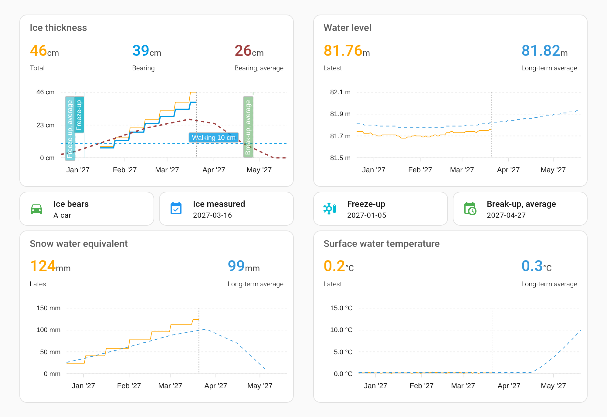
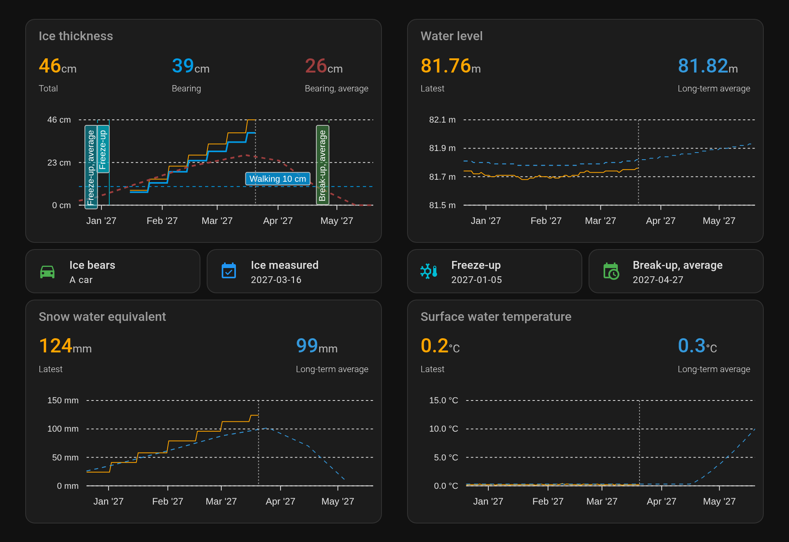

# SYKE hydrology for Home Assistant

Home Assistant integration for the lake and river measurements of the Finnish Environment Institute (Syke). It
follows water level, discharge, water temperature, ice, snow and precipitation, each with its long-term average.

[![GitHub Release][releases-shield]][releases] [![GitHub Release Date][release-date-shield]][releases] [![Downloads][downloads-shield]][releases] [![Marketplace][marketplace-shield]][marketplace] [![License][license-shield]](LICENSE)




The data in the picture is made up. The charts are drawn with
[apexcharts-card](https://github.com/RomRider/apexcharts-card), see [Examples](#examples).

## What is it?

A custom component that follows the hydrological measuring stations of the Finnish Environment Institute (Syke)
through its open Hydrologiarajapinta. There are some 1,600 stations around Finland, on lakes, rivers and snow
courses, and no account or key is needed.

You pick what to follow and then the station, from a list with the nearest first. Each measurement becomes a sensor,
and the measurements of one station share a device.

Every measurement also gets a **long-term average** sensor, which tells what the station has measured on this
calendar day over the last thirty full years. With it a chart shows at a glance whether the lake is higher, warmer or more thickly
frozen than usual, and where the average goes from here.

For an ice station the integration works out how much the ice bears, as a thickness and as a class (a person walking,
a snowmobile, a car), with limits you can change.

Sensors get the past year written into their statistics, so charts have a history from the start.

## Installation

### With the Marketplace

1. Open Settings › Marketplace, choose Add from link and paste `https://github.com/jesmak/syke_hydrology`
2. Open SYKE hydrology in the Marketplace and choose Install
3. Restart Home Assistant
4. Add the integration in Settings › Devices & services, and choose a measurement and a station

### Manual

1. Download the source code from the latest release
2. Copy the `custom_components/syke_hydrology` folder to your Home Assistant installation's `config/custom_components`
   folder
3. Restart Home Assistant
4. Add the integration in Settings › Devices & services, and choose a measurement and a station

## Settings

Adding takes two steps. First choose what to follow, then the station. The list has every station that measures it,
the nearest to your home first with its distance, and it can be searched by the name of a lake, a river, a village or
a municipality.

Each measurement is added on its own, with **Add entry** on the integration's page. A measurement of a station you
already have is added to that station, so its sensors join the same device. Reading thirty years for the averages
takes a few seconds when a measurement is added.

| Name        | Type | Description                               | Default  |
| ----------- | ---- | ----------------------------------------- | -------- |
| Measurement | enum | What to follow, one of the list below     | required |
| Station     | enum | A station that measures it, nearest first | required |

The measurements to choose from:

| Measurement                 | What Syke publishes                                                       |
| --------------------------- | ------------------------------------------------------------------------- |
| Water level                 | A lake's or a river's level, daily                                        |
| Discharge                   | A river's flow, daily                                                     |
| Surface water temperature   | The temperature near the surface, daily                                   |
| Ice thickness               | The ice measured through a drilled hole, about every ten days in winter   |
| Freeze-up and break-up      | The dates the ice came and went, as an observer saw them                  |
| Snow course                 | The snow's water equivalent along a measured course, a few times a winter |
| Areal snow water equivalent | The snow's water equivalent over a catchment area                         |
| Areal precipitation         | The precipitation over a catchment area, for five days and for a month    |

Ice thickness and the freeze-up and break-up dates are often measured at different stations, so they are added
separately and may end up as two devices on the same lake.

### Station settings

A station's **Configure** button has its settings. An ice station has the bearing limits, and a station with more
than one measurement has the list of them, where unticking one removes it with its sensors.

| Name                     | Type   | Description                                                     | Default |
| ------------------------ | ------ | --------------------------------------------------------------- | ------- |
| Bears a person walking   | number | The bearing thickness from which the ice bears a walker, in cm  | 10      |
| Bears a snowmobile       | number | The bearing thickness from which the ice bears a snowmobile, cm | 15      |
| Bears a car              | number | The bearing thickness from which the ice bears a car, in cm     | 20      |
| Measurement is old after | number | Days after which the last ice measurement is marked as old      | 14      |
| Measurements             | list   | The measurements followed at the station                        |         |

## Sensors

The sensors are read from Syke once an hour. Syke publishes the daily measurements a day or two late, and the ones
measured by hand when the observer has sent them in.

A sensor is unavailable when its newest measurement is too old to go by, so a season that ended doesn't draw a flat
line through the summer. The limit is 30 days, 60 days for a snow course and 62 days for a month's precipitation.
Each measurement sensor tells the day of its measurement in its `measured` attribute.

The entity ids below are those of a made-up station named Koivujärvi with Home Assistant in English. In another
language the ids follow that language's names.

| Measurement                 | Sensor                      | State                                             | Example                                         |
| --------------------------- | --------------------------- | ------------------------------------------------- | ----------------------------------------------- |
| Water level                 | Water level                 | Metres in the N2000 height system                 | `sensor.koivujarvi_water_level`                 |
| Discharge                   | Discharge                   | m³/s                                              | `sensor.koivujarvi_discharge`                   |
| Surface water temperature   | Surface water temperature   | °C                                                | `sensor.koivujarvi_surface_water_temperature`   |
| Ice thickness               | Ice thickness               | The whole ice, cm                                 | `sensor.koivujarvi_ice_thickness`               |
|                             | Clear ice thickness         | The clear ice in it, cm                           | `sensor.koivujarvi_clear_ice_thickness`         |
|                             | Snow ice thickness          | The snow ice in it, cm                            | `sensor.koivujarvi_snow_ice_thickness`          |
|                             | Snow on ice                 | The snow on the ice, cm                           | `sensor.koivujarvi_snow_on_ice`                 |
|                             | Ice bearing thickness       | The clear ice and half of the snow ice, cm        | `sensor.koivujarvi_ice_bearing_thickness`       |
|                             | Ice bears                   | `does_not_bear`, `walking`, `snowmobile` or `car` | `sensor.koivujarvi_ice_bears`                   |
|                             | Ice measured                | The date of the newest ice measurement            | `sensor.koivujarvi_ice_measured`                |
|                             | Ice measurement old         | On when that date is older than the limit         | `binary_sensor.koivujarvi_ice_measurement_old`  |
| Freeze-up and break-up      | Freeze-up                   | The date the whole view froze over                | `sensor.koivujarvi_freeze_up`                   |
|                             | Permanent ice cover         | The date the ice stayed for the winter            | `sensor.koivujarvi_permanent_ice_cover`         |
|                             | Ice gone from open water    | The date the open water outside was free of ice   | `sensor.koivujarvi_ice_gone_from_open_water`    |
|                             | Break-up                    | The date the whole view was free of ice           | `sensor.koivujarvi_break_up`                    |
| Snow course                 | Snow water equivalent       | mm of water                                       | `sensor.honkavaara_snow_water_equivalent`       |
| Areal snow water equivalent | Areal snow water equivalent | mm of water                                       | `sensor.koivujarvi_areal_snow_water_equivalent` |
| Areal precipitation         | Precipitation, 5 days       | mm over the newest five days                      | `sensor.koivujarvi_precipitation_5_days`        |
|                             | Precipitation, month        | mm over the newest month                          | `sensor.koivujarvi_precipitation_month`         |

A water level is in centimetres above the station's own zero when Syke gives the station no height system. The
`height_system` attribute tells which it is.

An observer doesn't record every ice event at every station, so a date sensor a station never gets a date for stays
unknown and can be disabled.

### Ice bearing

The **ice bearing thickness** is the clear ice plus half of the snow ice, the rule of thumb the limits are also
given in. It is 0 when the observer found ice too weak to measure. **Ice bears** compares it with the station's
limits.

The limits are rules of thumb, not a guarantee. Ice varies from place to place, one hole says nothing about currents
or cracks, and the measurement may be two weeks old. **Ice measurement old** turns on when it is older than the
station's limit, and the date of the measurement stays available all year.

### Long-term averages

Every measurement sensor has a sensor named after it, such as **Water level, long-term average**
(`sensor.koivujarvi_water_level_long_term_average`). Its state is the average of what the station measured on this
calendar day over the thirty full years before this one, and its `years` attribute tells which years they are. A day
gets an average when at least five of the years have a measurement for it, and a sensor with no such day is left out.

- The averages are read when a measurement is added and again when the year changes.
- Ice and snow courses are measured every ten days or so, so their average for a day is taken from the measurements
  within five days of it.
- The ice averages count open water as zero. Ice is measured only once it bears the observer, so without this the
  average of an early winter day would be that of the years that had ice. A winter counts as open water until ten days
  before its first measurement and from thirty days after its last. The ice averages therefore have a value all year.
- A snow course's average has a value only on the calendar days it has been measured in enough years, which is the
  snow season.
- Each freeze-up and break-up date gets an average date, such as **Freeze-up, long-term average**, in the season
  going on.

### The history

When a measurement is added, the past year is written into its sensors' statistics, the average sensors included, each
measurement at its own date. Every later measurement is written at its own date as well, whenever Syke publishes it.
Charts that read statistics, such as the ones below, therefore work from the first day.

## Examples

The charts in the picture are [apexcharts-card](https://github.com/RomRider/apexcharts-card) cards that read the
sensors' statistics. This one shows the water level for 90 days back and 60 ahead with its long-term average:

```yaml
type: custom:apexcharts-card
graph_span: 150d
span:
    offset: +60d
header:
    show: true
    title: Water level
    show_states: true
    colorize_states: true
all_series_config:
    curve: straight
    stroke_width: 1
    float_precision: 2
    statistics:
        type: mean
        period: day
        align: middle
apex_config:
    legend:
        show: false
series:
    - entity: sensor.koivujarvi_water_level
      name: Latest
      color: orange
      extend_to: now
    - entity: sensor.koivujarvi_water_level_long_term_average
      name: Long-term average
      color: "#3498db"
      stroke_dash: 5
      extend_to: now
    - entity: sensor.koivujarvi_water_level_long_term_average
      name: Long-term average, ahead
      color: "#3498db"
      stroke_dash: 5
      offset: -365d
      extend_to: false
      show:
          in_header: false
          offset_in_name: false
```

The line ahead is the third series. A calendar day's average is the same every year, so the average of a year ago,
moved a year forward with `offset`, is the average of the days to come. `extend_to: now` keeps the card from drawing
the newest value flat to the chart's right edge.

A freeze-up or break-up date can be drawn on a chart as a vertical line. The card evaluates the expression when it
loads, so a new date shows after the page is reloaded:

```yaml
apex_config:
    annotations:
        xaxis:
            - x: "EVAL:Date.parse((document.querySelector('home-assistant').hass.states['sensor.koivujarvi_freeze_up'] || {}).state + 'T00:00:00') || 0"
              borderColor: "#00acc1"
              label:
                  text: Freeze-up
                  orientation: vertical
                  style:
                      color: white
                      background: "#00acc1cc"
```

An automation that tells when the ice first bears a walker:

```yaml
triggers:
    - trigger: state
      entity_id: sensor.koivujarvi_ice_bears
      from: does_not_bear
      to: walking
actions:
    - action: notify.notify
      data:
          message: >-
              The ice at Koivujärvi bears a person walking,
              {{ states('sensor.koivujarvi_ice_bearing_thickness') }} cm of bearing ice.
```

## Data

The measurements come from Syke's open
[Hydrologiarajapinta](https://rajapinnat.ymparisto.fi/api/Hydrologiarajapinta/1.1/), licensed under
[CC BY 4.0](https://creativecommons.org/licenses/by/4.0/). The source is the Finnish Environment Institute (Syke),
and every sensor carries the attribution.

The integration's icon is Syke's logo, which belongs to Syke.

This integration is unofficial and not affiliated with or endorsed by Syke.

## Translating

The texts are in English and Finnish. A translation into another language is welcome as a pull request. Copy
`custom_components/syke_hydrology/translations/en.json` under the language's code and translate the values.

## Development

Requires Python 3.14.

```
python3.14 -m venv .venv
.venv/bin/pip install -r requirements_test.txt
.venv/bin/pytest
.venv/bin/ruff check .
```

| Path                            | What it contains                                                     |
| ------------------------------- | -------------------------------------------------------------------- |
| `__init__.py`                   | Setup, and reading the averages again when the year changes          |
| `config_flow.py`                | Choosing a measurement and a station, and a station's settings       |
| `const.py`                      | The option names and their defaults                                  |
| `api.py`                        | Reading the stations and their rows from Syke's OData service        |
| `coordinator.py`                | Fetching a station's measurements, every hour                        |
| `measurements.py`               | Turning Syke's rows into what the sensors show, the ice bearing too  |
| `averages.py`                   | The long-term averages by calendar day, and the average dates        |
| `long_term.py`                  | Reading thirty years for the averages and keeping them over restarts |
| `history.py`                    | Writing the measurements into long-term statistics                   |
| `entity.py`                     | The station's device                                                 |
| `sensor.py`, `binary_sensor.py` | The sensors                                                          |
| `translations/<language>.json`  | Home Assistant UI texts                                              |

The README's screenshots come from made-up data, written by `docs/screenshots.py` into `docs/screenshots.json`.

## Support

Hey dude! Help me out for a couple of :beers: or a :coffee:!

[](https://www.buymeacoffee.com/jesmak)

## License

MIT, see [LICENSE](LICENSE). The data is Syke's, see [Data](#data).

[releases-shield]: https://img.shields.io/github/release/jesmak/syke_hydrology.svg?style=for-the-badge
[release-date-shield]: https://img.shields.io/github/release-date/jesmak/syke_hydrology?style=for-the-badge
[releases]: https://github.com/jesmak/syke_hydrology/releases
[downloads-shield]: https://img.shields.io/github/downloads/jesmak/syke_hydrology/total.svg?style=for-the-badge
[marketplace-shield]: https://img.shields.io/badge/Marketplace-Custom-orange.svg?style=for-the-badge
[marketplace]: https://my.home-assistant.io/redirect/marketplace_repository/?owner=jesmak&repository=syke_hydrology&category=integration
[license-shield]: https://img.shields.io/github/license/jesmak/syke_hydrology.svg?style=for-the-badge
